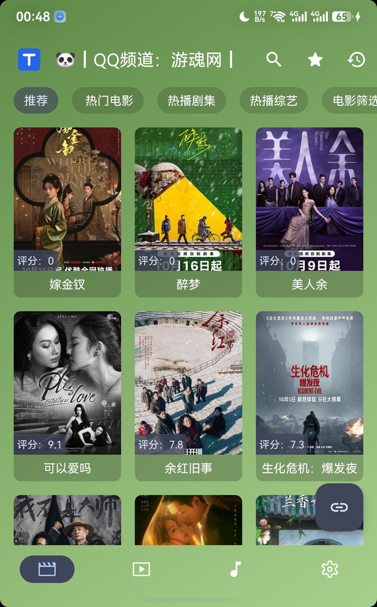
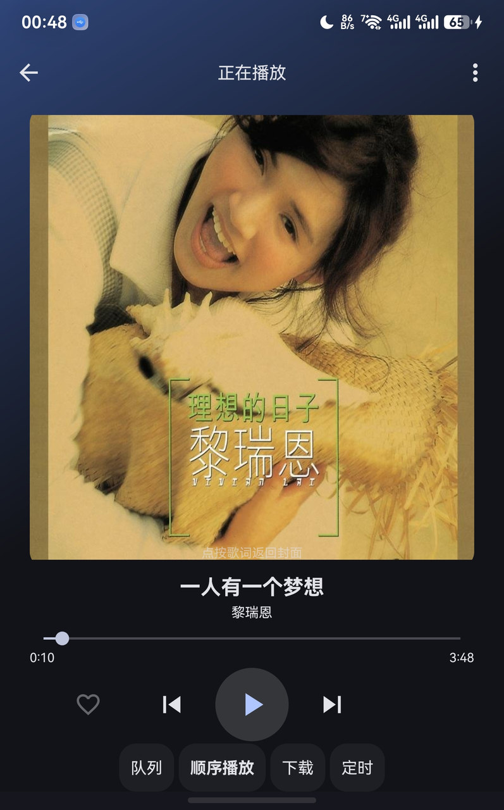
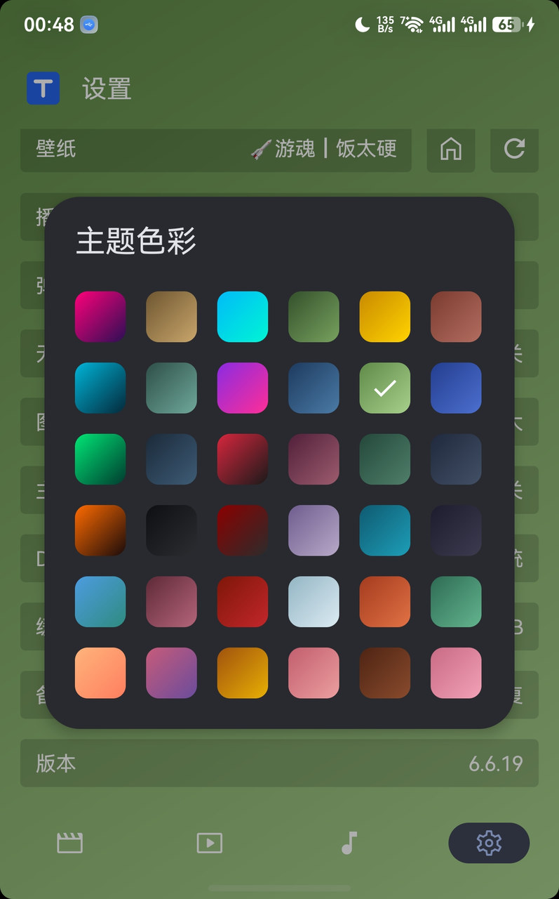

<div align="center">

# MTBOX

**基于 FongMi/TV 二次开发的安卓视频 / 本地音乐播放工具箱**
**An Android video & local-music toolbox, secondary-developed from FongMi/TV**

[](LICENSE)
[](#-目录结构--directory)
[](THIRD_PARTY_NOTICES.md)
[](CHANGELOG.md)

[中文](#中文) · [English](#english)

**官方项目页 / Project page**: <https://ttread.cn/works/mtbox/>
（中文 · [English](https://ttread.cn/en/works/mtbox/) · bilingual）

</div>

---

<a name="中文"></a>

## 中文

### 这是什么

MTBOX 是基于 **FongMi/TV（GPL-3.0）** 二次开发的安卓播放工具箱，包名 `com.matou.mtbox`，
当前版本 **6.6.19**（`versionCode 60619`）。它分两部分：

- **`work_fong/`** —— FongMi/TV 5.6.1 反编译基线 + 逐条打好的 smali 补丁
- **`javainject/`** —— 本次新增的**本地音乐播放引擎**（13 个 Java 文件），以 `classes4.dex`
  直接注入，不走 smali 回编

**它不做的事**：不内置任何内容源、不提供任何在线解析地址、不收集任何用户数据。
所有外部订阅源由使用者自行配置。

### 界面

| 本地音乐 | 歌词 | 主题 |
|---|---|---|
|  |  |  |

### 特性

- **本地音乐引擎** —— 扫描本地音频，`MediaSession` + `MediaStyle` 通知控制，锁屏 / 控制中心可用
- **网易云搜索与歌词** —— 歌名搜索、LRC 歌词实时同步、封面降级加载
- **音效链路透明** —— 只有 `Equalizer` + `BassBoost`，**不启用 `LoudnessEnhancer`**，1.0 倍速
  不调 `setPlaybackParams`，FLAC 走原生直通
- **安全加固** —— NanoHTTPD 绑定 `127.0.0.1`；移除 6 个危险权限；扫码不再开摄像头
- **主题统一** —— 页内 Logo 统一、颜色走 `?attr/colorSurface`，不写死色值
- **自建签名** —— 用自己的 keystore 出包，`apksigner verify` 校验 v2/v3

### 目录结构

```
work_fong/           反编译基线（FongMi/TV 5.6.1 → com.matou.mtbox 6.6.19）
  smali*/            smali 补丁
  res/               资源（主题 / 布局）
  assets/            chaquopy 运行时、直播内核 libmitv.so
  lib/arm64-v8a/     FFmpeg、mpv、迅雷、QuickJS 原生库
  unknown/           第三方 LICENSE 原文
javainject/
  src/               音乐引擎 Java 源码（GPL-3.0）
  tool/              smali/dex 辅助工具
  build.ps1          构建脚本（apktool 两遍出包 + 签名）
  genr.ps1           由 public.xml + aapt2 生成 R.java
tools/               smalldiff.ps1（smali 差异比对）
docs/                界面截图与方案留档
THIRD_PARTY_NOTICES.md   第三方授权声明
LICENSE              GPL-3.0
```

### 构建

前置：apktool、Android SDK build-tools 37.0.0、`apksigner`、JDK（DevEco JBR 即可）。

```powershell
# 1) 生成 R.java（必须先跑，资源 id 会漂移）
powershell -File javainject\genr.ps1 -Apk <刚构建出来的.apk>

# 2) 构建 + 注入 + 签名（apktool 跑两遍，不要跳 pass1）
$env:MTBOX_KS_PASS = '<keystore password>'
$env:MTBOX_KEY_PASS = '<key password>'
powershell -File javainject\build.ps1 -Tag music
```

**输出**：`D:\MTBOX\mtbox-music-signed.apk`

> ⚠️ `build.ps1` 里 `$SDK` / `$JBR` 是本机绝对路径，需要改成你自己的路径。
> 签名 keystore **不在仓库里**，需要你自己生成一个。

### 免责声明

1. 本项目基于 [FongMi/TV](https://github.com/FongMi/TV)（GPL-3.0）二次开发，**不包含任何内容源**，
   也不提供任何在线解析地址。
2. 所有外部订阅源、频道与解析地址由使用者**自行配置**，与本项目无关。
3. 本项目**不提供任何商业服务**，不收费、不收款、不构成任何交易关系。
4. 本项目仅用于**个人学习与技术研究**，请遵守当地法律法规。
5. 因使用本软件产生的任何法律后果，**由使用者自行承担**。
6. 上游第三方组件（迅雷 SDK、ForceTV、mpv 等）的授权条款请见
   [`THIRD_PARTY_NOTICES.md`](THIRD_PARTY_NOTICES.md)，**重新分发前请自行核实**。

---

<a name="english"></a>

## English

### What this is

MTBOX is an Android media toolbox **secondary-developed from [FongMi/TV](https://github.com/FongMi/TV)**
(GPL-3.0). Package `com.matou.mtbox`, current version **6.6.19** (`versionCode 60619`).
The repository has two halves:

- **`work_fong/`** — the decompiled FongMi/TV 5.6.1 baseline plus the smali patches applied
  on top of it
- **`javainject/`** — the **local music engine** added in this project (13 Java files),
  injected straight in as `classes4.dex` with no smali round-trip

**What it does not do**: it ships no content sources, no online parsing URLs, and collects
no user data. Every external subscription is configured by the user.

### Features

- **Local music engine** — scans local audio, controlled via `MediaSession` + `MediaStyle`
  notification, works from the lock screen and the control centre
- **NetEase search & lyrics** — track search, synced LRC lyrics, cover art with fallback
- **Transparent audio path** — only `Equalizer` + `BassBoost`; `LoudnessEnhancer` is
  never enabled and `setPlaybackParams` is never touched at 1.0×, so FLAC stays bit-perfect
- **Hardened** — NanoHTTPD bound to `127.0.0.1`; six dangerous permissions removed; the
  scanner no longer opens the camera
- **Self-signed** — built with your own keystore, verified by `apksigner verify` (v2/v3)

### Directory

```
work_fong/           decompiled baseline (FongMi/TV 5.6.1 → com.matou.mtbox 6.6.19)
  smali*/            smali patches
  res/               resources (theme / layouts)
  assets/            chaquopy runtime, libmitv.so live kernel
  lib/arm64-v8a/     FFmpeg, mpv, Thunder, QuickJS native libs
  unknown/           third-party LICENSE texts
javainject/
  src/               music engine Java sources (GPL-3.0)
  tool/              smali/dex helpers
  build.ps1          build script (two-pass apktool + sign)
  genr.ps1           generate R.java from public.xml + aapt2
tools/               smalldiff.ps1
docs/                screenshots
THIRD_PARTY_NOTICES.md   third-party notices
LICENSE              GPL-3.0
```

### Build

Prerequisites: apktool, Android SDK build-tools 37.0.0, `apksigner`, a JDK
(the DevEco JBR works).

```powershell
# 1) generate R.java (must run first — resource ids shift)
powershell -File javainject\genr.ps1 -Apk <freshly built .apk>

# 2) build + inject + sign (apktool runs twice — do not skip pass 1)
$env:MTBOX_KS_PASS = '<keystore password>'
$env:MTBOX_KEY_PASS = '<key password>'
powershell -File javainject\build.ps1 -Tag music
```

**Output**: `D:\MTBOX\mtbox-music-signed.apk`

> ⚠️ `$SDK` / `$JBR` in `build.ps1` are machine-absolute paths — change them to yours.
> The signing keystore is **not** in this repo; generate your own.

### Disclaimer

1. This project is a secondary development of [FongMi/TV](https://github.com/FongMi/TV)
   (GPL-3.0). It ships **no content sources** and **no online parsing URLs**.
2. Every external subscription, channel and parsing URL is configured by the user and is
   **not provided by this project**.
3. This project offers **no commercial service**: no fees, no payment, no transaction of
   any kind.
4. This project is for **personal study and technical research only**. Follow local laws.
5. The user alone is **responsible** for any legal consequence of using this software.
6. Upstream third-party terms (Thunder SDK, ForceTV, mpv, …) are listed in
   [`THIRD_PARTY_NOTICES.md`](THIRD_PARTY_NOTICES.md) — **verify them before redistributing**.

---

## 许可 / License

[GPL-3.0](LICENSE) · 基于 FongMi/TV · 第三方组件见 [`THIRD_PARTY_NOTICES.md`](THIRD_PARTY_NOTICES.md)

**别商用，别拿去收钱。** / **No commercial use. Do not charge for it.**
